# Лабораторная работа № 4

**Тема** · Связи моделей и внешний вид шаблона  
**Вариант 3** · Библиотека: книги и авторы  
**Выполнил** · Ануфриев Владислав Денисович, группа ПИЖ-б-о-25-2  
**Северо-Кавказский федеральный университет**, Ставрополь, 2026

## Запуск проекта

Откройте в VS Code скачанную папку с этим README. Для запуска нужен Python 3.12 или новее. В новом терминале выполните команды.

```bat
cd Django
python -m pip install Django Pillow
python manage.py runserver
```

В базе уже есть три автора, четыре книги и демонстрационный администратор. После запуска откройте [каталог](http://127.0.0.1:8000/) или [админку](http://127.0.0.1:8000/admin/).

- Логин · `demo_admin`
- Пароль · `Lab4-pkeIc92YQ52sCw`

## Структура папки

- `Django/` — код, шаблон, настройки, миграции, тесты и список зависимостей.
- `Screenshots/` — все изображения, вставленные в отчёт.
- `Data/` — готовая учебная база SQLite.
- `Materials/` — текстовые журналы миграций и запросов SQLite.

## Цель работы

Создать библиотеку на Django, связать книги с авторами через `ForeignKey`, применить миграции SQLite и проверить работу связи в админке. Вывести книги и имена авторов на отдельной странице с помощью шаблона Django.

## Теоретическое обоснование

| Поле Django | Тип связи | Пример |
| --- | --- | --- |
| `ForeignKey` | Многие к одному | Один автор написал несколько книг, у каждой книги один автор. |
| `ManyToManyField` | Многие ко многим | Книга может относиться к нескольким жанрам, а жанр — включать несколько книг. |
| `OneToOneField` | Один к одному | У автора одна карточка дополнительной информации. |

## Ход работы

### 1. Создание связанных моделей

В `Author` добавлены имя, фамилия, биография и фото. Биография и фото необязательны. Для биографии `default=""` задаёт пустую строку.

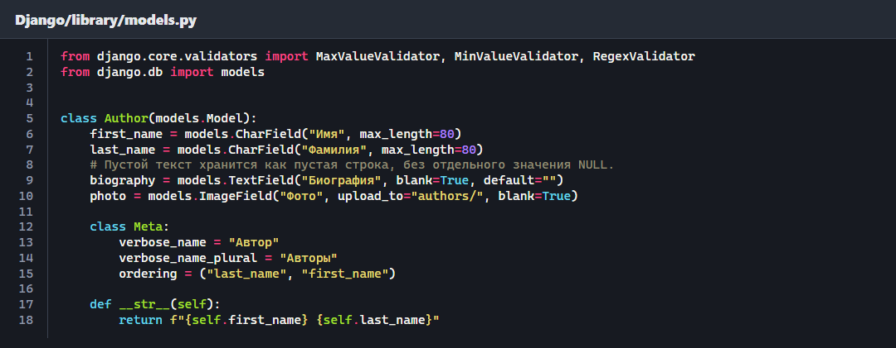

*Рисунок 1. Модель Author в файле models.py.*

В `Book` добавлены название, год издания, уникальный ISBN и обязательная ссылка `author`. Параметр `null=False` запрещает `NULL` в базе, а `blank=False` требует выбрать автора в форме. `CASCADE` удаляет связанные книги при удалении автора. `related_name="books"` позволяет получить их через `author.books.all()`.

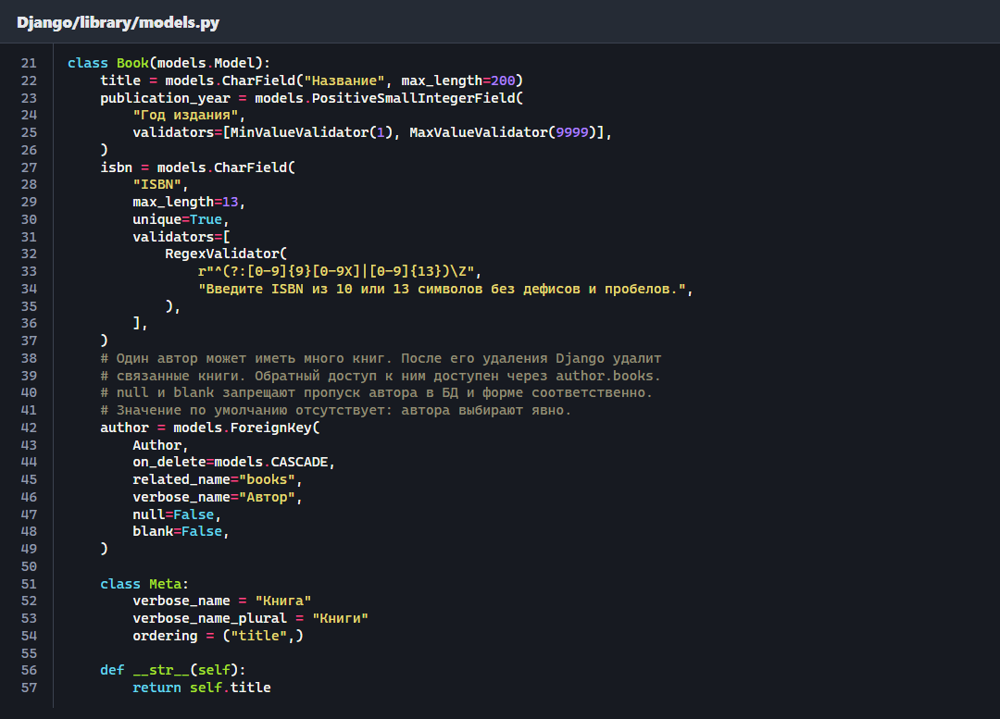

*Рисунок 2. Модель Book и параметры связи с автором.*

<details>
<summary>Полный код моделей</summary>

```python
from django.core.validators import MaxValueValidator, MinValueValidator, RegexValidator
from django.db import models


class Author(models.Model):
    first_name = models.CharField("Имя", max_length=80)
    last_name = models.CharField("Фамилия", max_length=80)
    # Пустой текст хранится как пустая строка, без отдельного значения NULL.
    biography = models.TextField("Биография", blank=True, default="")
    photo = models.ImageField("Фото", upload_to="authors/", blank=True)

    class Meta:
        verbose_name = "Автор"
        verbose_name_plural = "Авторы"
        ordering = ("last_name", "first_name")

    def __str__(self):
        return f"{self.first_name} {self.last_name}"


class Book(models.Model):
    title = models.CharField("Название", max_length=200)
    publication_year = models.PositiveSmallIntegerField(
        "Год издания",
        validators=[MinValueValidator(1), MaxValueValidator(9999)],
    )
    isbn = models.CharField(
        "ISBN",
        max_length=13,
        unique=True,
        validators=[
            RegexValidator(
                r"^(?:[0-9]{9}[0-9X]|[0-9]{13})\Z",
                "Введите ISBN из 10 или 13 символов без дефисов и пробелов.",
            ),
        ],
    )
    # Один автор может иметь много книг. После его удаления Django удалит
    # связанные книги. Обратный доступ к ним доступен через author.books.
    # null и blank запрещают пропуск автора в БД и форме соответственно.
    # Значение по умолчанию отсутствует: автора выбирают явно.
    author = models.ForeignKey(
        Author,
        on_delete=models.CASCADE,
        related_name="books",
        verbose_name="Автор",
        null=False,
        blank=False,
    )

    class Meta:
        verbose_name = "Книга"
        verbose_name_plural = "Книги"
        ordering = ("title",)

    def __str__(self):
        return self.title
```

</details>

[Исходный файл models.py](Django/library/models.py).

### 2. Миграции и структура базы

Команда `makemigrations library` создала `0001_initial.py`. Команда `migrate` применила миграцию и создала таблицы. Проверка `makemigrations --check --dry-run` подтвердила, что изменения моделей отражены в миграциях. [Файл миграции](Django/library/migrations/0001_initial.py) · [Журнал команд](Materials/Logs/django-migrations.txt).

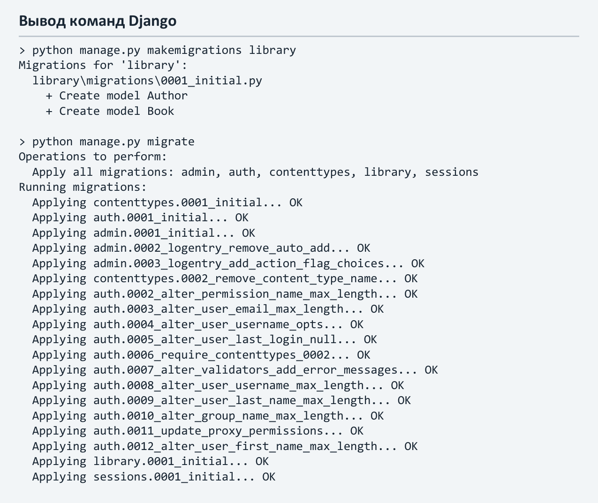

*Рисунок 3. Вывод команд миграции.*

Запрос `PRAGMA table_info` показал структуру таблиц `library_author` и `library_book`. У `author_id` установлено `notnull=1`. [Результат запроса](Materials/Logs/sqlite-tables.txt).

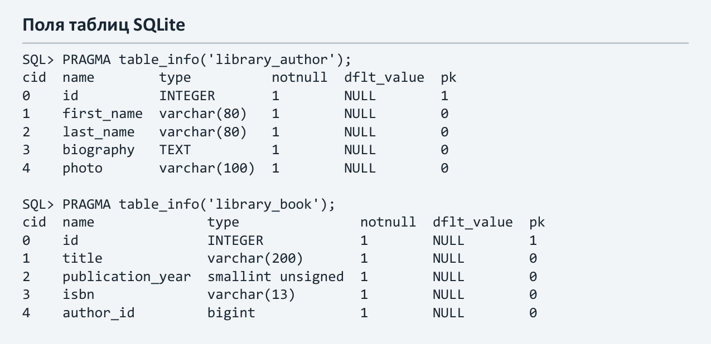

*Рисунок 4. Поля таблиц авторов и книг.*

Запрос `PRAGMA foreign_key_list` подтвердил связь `library_book.author_id → library_author.id`. Проверка `foreign_key_check` вернула ноль строк, а запрос по индексам показал уникальность ISBN. [Результаты запросов](Materials/Logs/sqlite-constraints.txt).

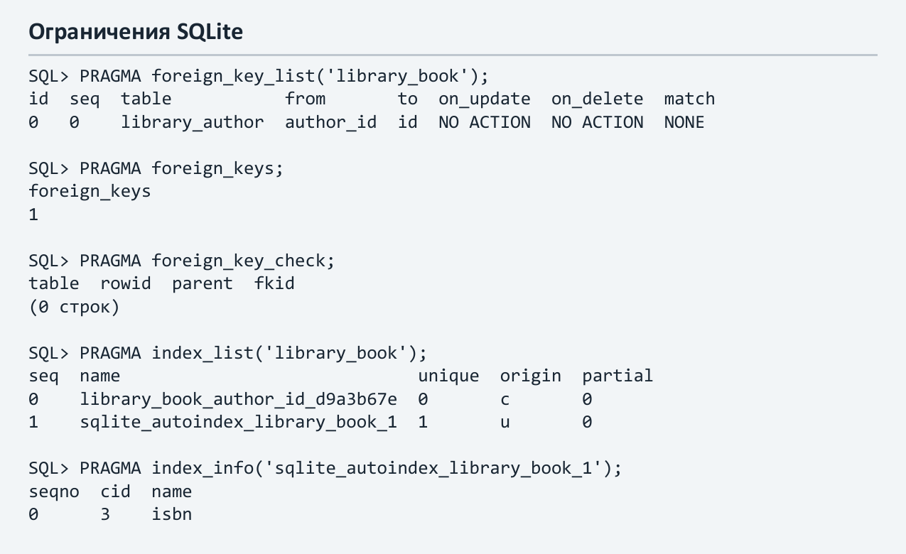

*Рисунок 5. Ограничения SQLite и результат проверки целостности.*

### 3. Настройка админки

Обе модели зарегистрированы в `admin.py`. В карточке автора выводятся его книги. В списке книг `list_display` задаёт столбцы, `list_filter` фильтрует по автору и году, `list_editable` разрешает менять год, а `search_fields` позволяет искать по названию, ISBN и фамилии автора. [Исходный файл admin.py](Django/library/admin.py).

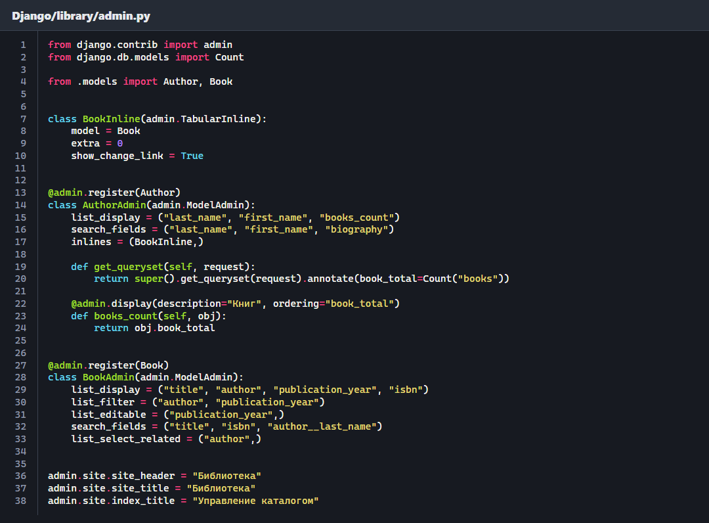

*Рисунок 6. Регистрация и настройка моделей в admin.py.*

В `settings.py` задан русский язык, а `verbose_name` в `apps.py` задаёт название приложения «Библиотека» в меню админки. [Настройки проекта](Django/config/settings.py) · [Настройки приложения](Django/library/apps.py).

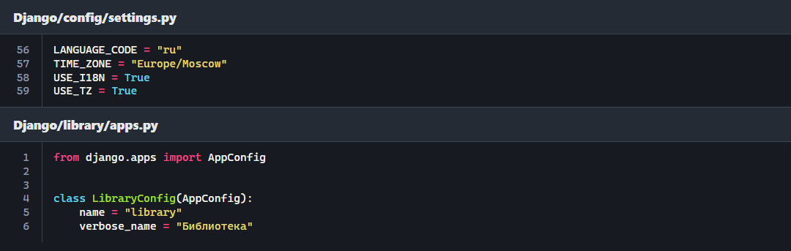

*Рисунок 7. Язык интерфейса и название приложения.*

После входа в админку доступны разделы «Авторы» и «Книги».

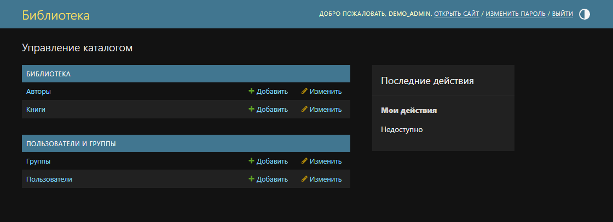

*Рисунок 8. Разделы приложения на главной странице админки.*

### 4. Добавление записей и фильтрация

На отдельной копии учебной базы добавлен автор Павел Орлов. Проверена загрузка фото. В форме книги автор выбран из списка.

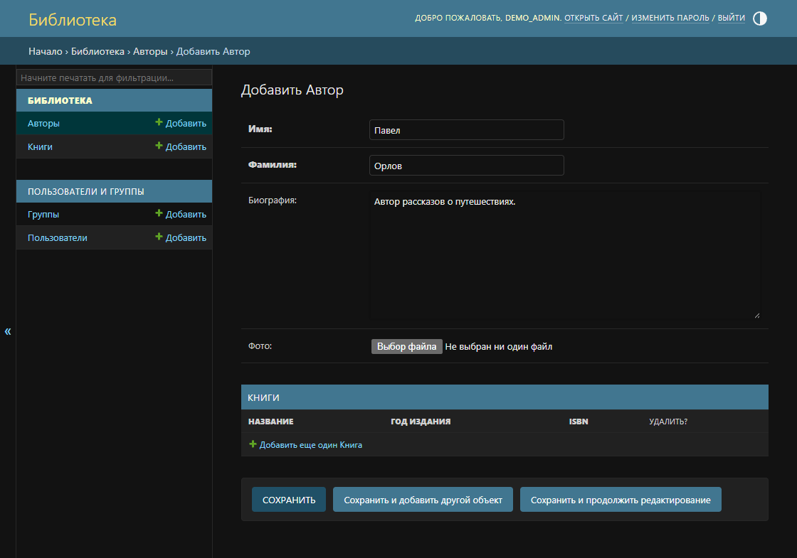

*Рисунок 9. Заполнение формы автора.*

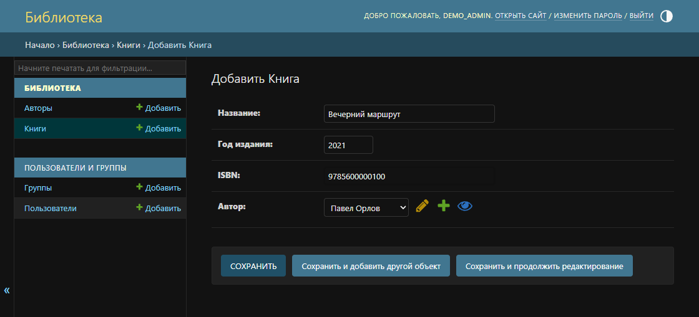

*Рисунок 10. Выбор автора при добавлении книги.*

Год книги «Вечерний маршрут» изменён с 2021 на 2022 прямо в списке. После отбора по Анне Волковой остались две её книги. Поиск по фамилии «Морозов» вернул книгу «Карта звёздного неба».

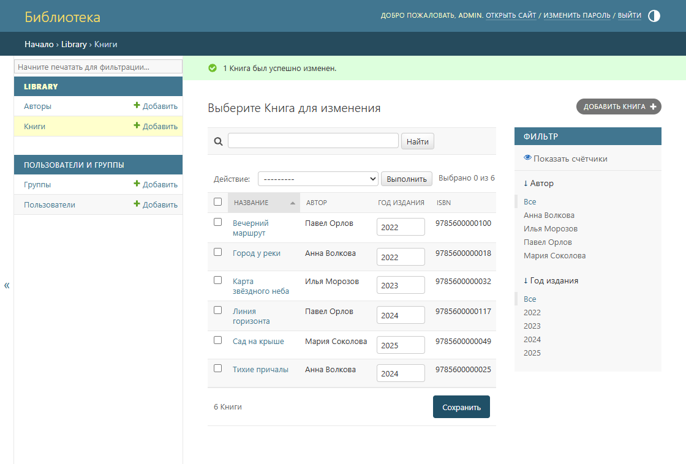

*Рисунок 11. Результат изменения года издания.*

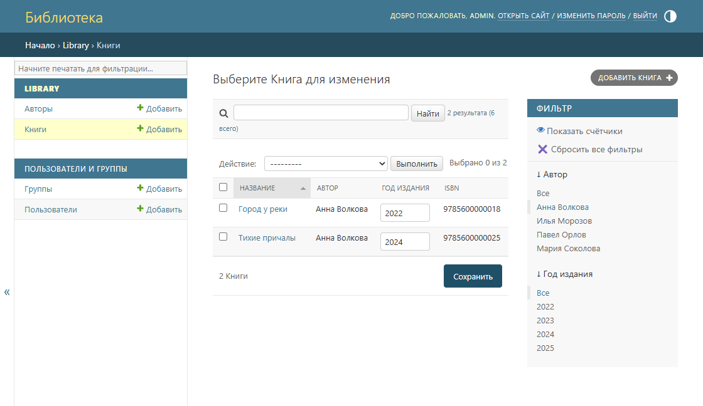

*Рисунок 12. Две книги Анны Волковой.*

### 5. Каскадное удаление

Страница подтверждения перечислила Павла Орлова и обе его книги. После удаления в каталоге остались четыре книги остальных авторов. В SQLite внешний ключ отмечен как `NO ACTION`, поскольку каскад при таком удалении выполняет ORM Django.

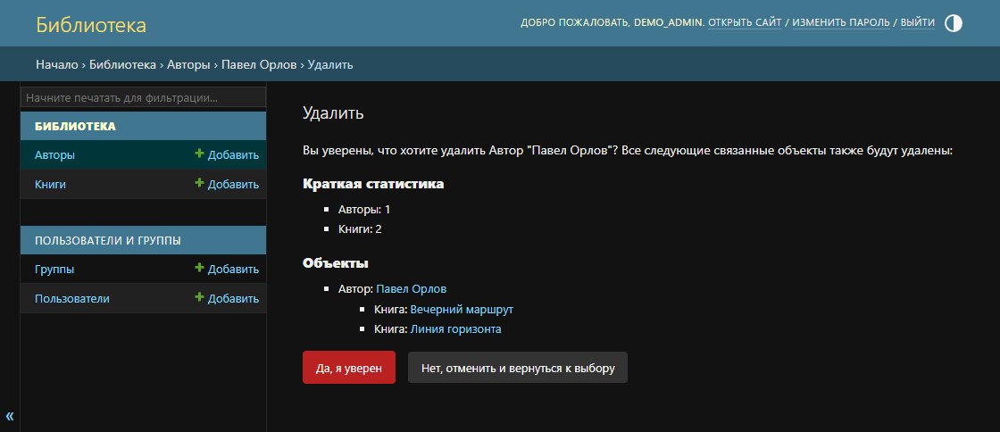

*Рисунок 13. Связанные книги в списке объектов на удаление.*

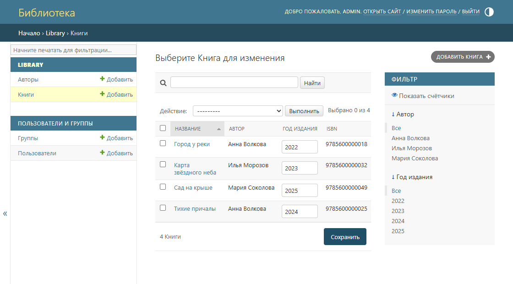

*Рисунок 14. Четыре книги после каскадного удаления.*

### 6. Маршруты и представление

Корневой маршрут подключает `library.urls` и вызывает `views.index`, а `/admin/` ведёт в админку. Представление получает книги вместе с авторами через `select_related("author")` и передаёт их в контексте шаблона. [Маршруты проекта](Django/config/urls.py) · [Маршруты приложения](Django/library/urls.py) · [Представление](Django/library/views.py).

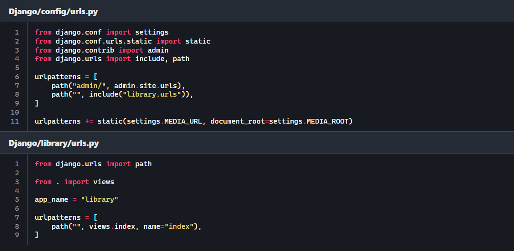

*Рисунок 15. Маршруты каталога и административной панели.*

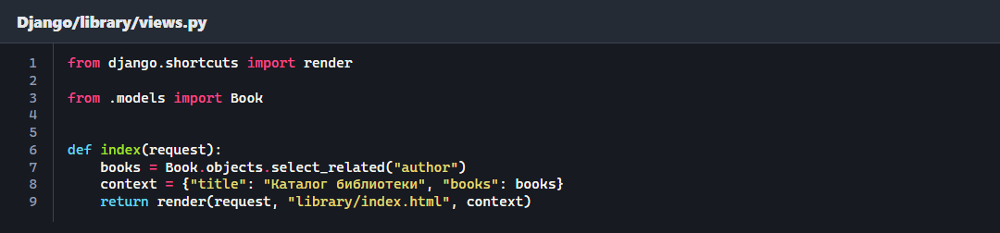

*Рисунок 16. Получение данных и вызов render().*

### 7. Шаблон и результат

В `index.html` цикл `` формирует строки таблицы. В каждую строку выводятся название, автор, год и ISBN. Ветка `` выводит сообщение для пустого каталога. Фильтр `unlocalize` сохраняет год в виде числа без разделителей разрядов. [Шаблон каталога](Django/library/templates/library/index.html).

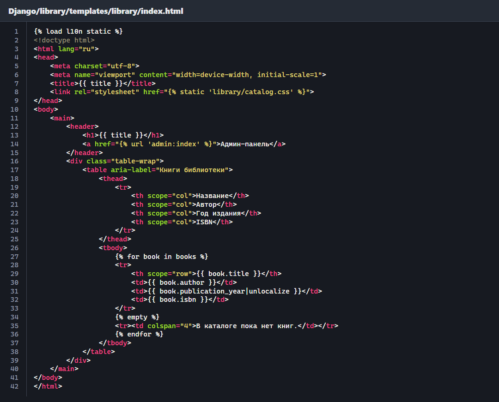

*Рисунок 17. Шаблон Django с циклом вывода книг.*

В браузере каталог отобразил четыре учебные книги вместе с именами их авторов.

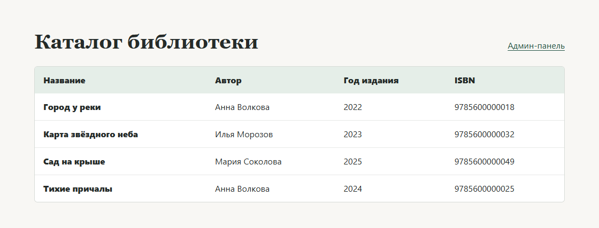

*Рисунок 18. Результат вывода книг через шаблон.*

## Вывод

Реализована связь «один автор — много книг». Внешний ключ проверен в SQLite, а поведение `CASCADE` — удалением автора через админку. Настроены формы, поиск, фильтры и отдельная страница каталога. Четыре автоматических теста проверили обязательность автора, каскадное удаление и отображение заполненного и пустого каталога.

## Вопросы и ответы

### Какие типы связей есть в Django

`ForeignKey` задаёт связь «многие к одному», `ManyToManyField` — «многие ко многим», `OneToOneField` — «один к одному». Для каталога выбран `ForeignKey`, потому что одному автору может принадлежать несколько книг, а каждая книга ссылается на одного автора.

### Где хранится связь и зачем нужен related_name

В таблице `library_book` столбец `author_id` хранит идентификатор автора. `book.author` возвращает автора конкретной книги, а `related_name="books"` даёт обратный доступ к его книгам через `author.books.all()`.

### Что означают null, blank и default

`null` определяет, допускает ли база значение `NULL`. `blank` определяет, можно ли оставить поле пустым в форме. `default` задаёт значение при создании объекта без этого поля. Для ссылки на автора заданы `null=False` и `blank=False`, а автора выбирают явно. У биографии значение по умолчанию — пустая строка.

### Что происходит при удалении автора

`on_delete=models.CASCADE` поручает Django удалить книги автора вместе с ним. Поэтому SQLite может показать `NO ACTION` в структуре внешнего ключа, а удаление в Django всё равно будет каскадным. Книги других авторов остаются в базе.

### Чем отличаются makemigrations и migrate

`makemigrations` создаёт файл с изменениями схемы, а `migrate` применяет его к базе. Команда `showmigrations library` показывает состояние миграций. `[X]` означает, что миграция применена, а `[ ]` — что она ещё ожидает применения.

### Что будет, если миграция завершится ошибкой

Следующая миграция, которая от неё зависит, дождётся её успешного выполнения. Независимую миграцию другого приложения можно применить отдельно командой `migrate имя_приложения`, если в её цепочке зависимостей нет ошибочной миграции.

### Для чего нужны параметры админки

`list_display` задаёт видимые столбцы, `list_filter` — фильтры, `list_editable` — редактируемые поля в списке, `search_fields` — поля, по которым работает поиск. В проекте год издания можно изменить прямо в списке книг.

### Где хранятся данные для входа

Демонстрационный администратор находится в таблице `auth_user` базы `Data/db.sqlite3`. Django хранит хеш пароля и проверяет его при входе. Данные учебной учётной записи указаны в разделе запуска.


### Как книги попадают на страницу каталога

`urls.py` передаёт запрос в `views.index`. Представление получает книги из SQLite и передаёт их в шаблон `library/index.html`. Django выполняет цикл в шаблоне и отправляет готовый HTML браузеру.
